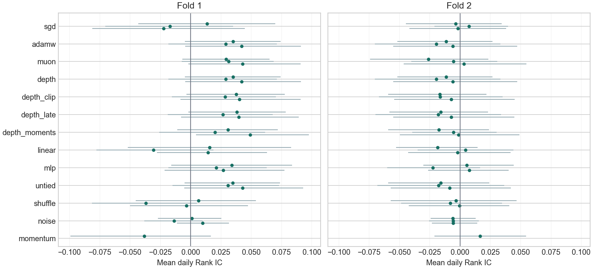

# LoopAlpha experiment results

Market input type: `market`. Market results use 3 training seeds unless the method is deterministic.

## Market panel

### Fold 1

Session boundaries [670, 893, 1116]. Labeled train, validation and test counts [18990, 6510, 6510].

| Method | Test MSE ± SD | Rank IC ± SD | Rank IC > 0 | Median IC dates | Net return at 10 bps | Priced runs |
|---|---:|---:|---:|---:|---:|---:|
| sgd | 1.0440 ± 0.0092 | -0.0086 ± 0.0193 | 0.476 | 217 | -6.02% | 3/3 |
| adamw | 1.0399 ± 0.0046 | 0.0354 ± 0.0066 | 0.555 | 217 | 0.80% | 3/3 |
| muon | 1.0387 ± 0.0045 | 0.0344 ± 0.0073 | 0.562 | 217 | 1.94% | 3/3 |
| depth | 1.0399 ± 0.0046 | 0.0354 ± 0.0066 | 0.555 | 217 | 0.80% | 3/3 |
| depth_clip | 1.0388 ± 0.0041 | 0.0354 ± 0.0061 | 0.551 | 217 | 2.38% | 3/3 |
| depth_late | 1.0391 ± 0.0046 | 0.0348 ± 0.0071 | 0.547 | 217 | 3.74% | 3/3 |
| depth_moments | 1.0418 ± 0.0049 | 0.0333 ± 0.0147 | 0.553 | 217 | 1.12% | 3/3 |
| linear | 1.0745 ± 0.0207 | -0.0002 ± 0.0264 | 0.496 | 217 | -12.84% | 3/3 |
| mlp | 1.0410 ± 0.0077 | 0.0274 ± 0.0065 | 0.548 | 217 | 13.09% | 3/3 |
| untied | 1.0398 ± 0.0055 | 0.0362 ± 0.0061 | 0.544 | 217 | 0.52% | 3/3 |
| shuffle | 1.0390 ± 0.0030 | -0.0114 ± 0.0228 | 0.485 | 217 | 2.61% | 3/3 |
| noise | 1.0444 ± 0.0037 | -0.0010 ± 0.0119 | 0.504 | 217 | -13.32% | 3/3 |
| momentum | — | -0.0382 | 0.442 | 217 | -34.02% | 1/1 |

### Fold 2

Session boundaries [893, 1116, 1489]. Labeled train, validation and test counts [25680, 6510, 9671].

| Method | Test MSE ± SD | Rank IC ± SD | Rank IC > 0 | Median IC dates | Net return at 10 bps | Priced runs |
|---|---:|---:|---:|---:|---:|---:|
| sgd | 1.0347 ± 0.0046 | 0.0005 ± 0.0059 | 0.491 | 335 | -17.22% | 1/3 |
| adamw | 1.0341 ± 0.0083 | -0.0124 ± 0.0069 | 0.483 | 335 | -22.89% | 1/3 |
| muon | 1.0315 ± 0.0064 | -0.0095 ± 0.0151 | 0.484 | 335 | — | 0/3 |
| depth | 1.0341 ± 0.0083 | -0.0124 ± 0.0069 | 0.483 | 335 | -22.89% | 1/3 |
| depth_clip | 1.0343 ± 0.0102 | -0.0135 ± 0.0053 | 0.480 | 335 | — | 0/3 |
| depth_late | 1.0342 ± 0.0098 | -0.0138 ± 0.0056 | 0.478 | 335 | — | 0/3 |
| depth_moments | 1.0357 ± 0.0076 | -0.0081 ± 0.0085 | 0.482 | 335 | — | 0/3 |
| linear | 1.0437 ± 0.0101 | -0.0054 ± 0.0118 | 0.504 | 335 | -3.44% | 1/3 |
| mlp | 1.0361 ± 0.0021 | -0.0031 ± 0.0167 | 0.508 | 335 | — | 0/3 |
| untied | 1.0346 ± 0.0091 | -0.0142 ± 0.0048 | 0.464 | 335 | -23.82% | 1/3 |
| shuffle | 1.0304 ± 0.0018 | -0.0040 ± 0.0038 | 0.506 | 335 | -19.00% | 1/3 |
| noise | 1.0339 ± 0.0054 | -0.0059 ± 0.0002 | 0.484 | 335 | -15.30% | 1/3 |
| momentum | — | 0.0164 | 0.531 | 335 | — | 0/1 |

Each point is one training seed or the deterministic momentum rule. Intervals are 95% circular date-block bootstrap intervals within that seed and fold.

Full per-run JSON contains elapsed time, parameter counts, probe tensor bytes, daily-IC summary statistics and the complete cost sweep. Tuning traces give trial-level failures.
