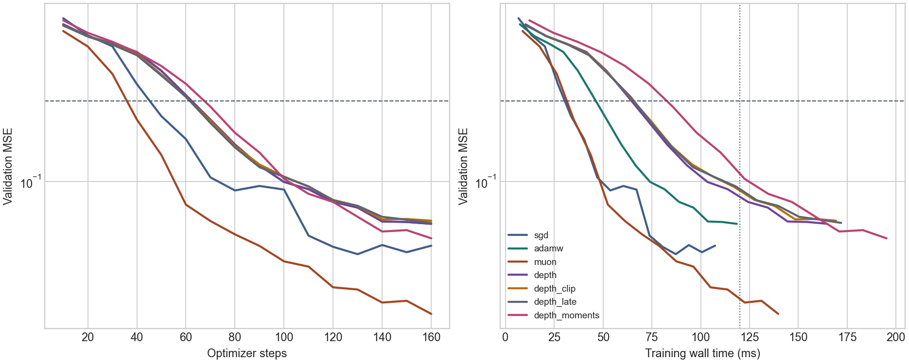
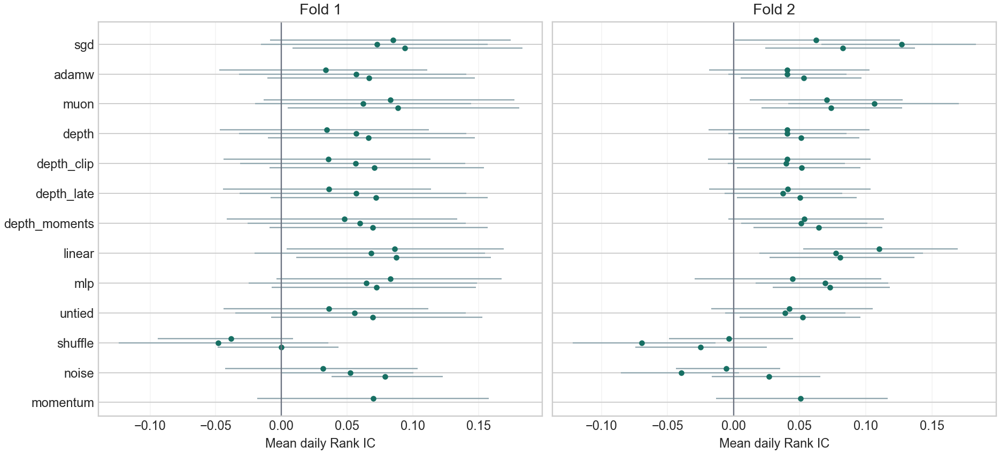

# LoopAlpha experiment results

Market input type: `synthetic-market`. Results use three training seeds unless the method is deterministic.

## Controlled sequence task

| Method | LR | Step-160 MSE ± SD | 120 ms MSE ± SD | Median checkpoint | Median threshold ms | Threshold hits | Run failures |
|---|---:|---:|---:|---:|---:|---:|---:|
| sgd | 0.03 | 0.0547 ± 0.0087 | 0.0547 ± 0.0087 (3/3) | 160 | 33.9 | 3/3 | 0/3 |
| adamw | 0.003 | 0.0637 ± 0.0085 | 0.0637 ± 0.0085 (3/3) | 160 | 51.9 | 3/3 | 0/3 |
| muon | 0.01 | 0.0326 ± 0.0029 | 0.0396 ± 0.0017 (3/3) | 130 | 35.0 | 3/3 | 0/3 |
| depth | 0.003 | 0.0637 ± 0.0085 | 0.0874 ± 0.0092 (3/3) | 110 | 72.4 | 3/3 | 0/3 |
| depth_clip | 0.003 | 0.0652 ± 0.0093 | 0.0878 ± 0.0091 (3/3) | 110 | 74.4 | 3/3 | 0/3 |
| depth_late | 0.003 | 0.0646 ± 0.0093 | 0.0880 ± 0.0101 (3/3) | 110 | 74.7 | 3/3 | 0/3 |
| depth_moments | 0.003 | 0.0592 ± 0.0057 | 0.1749 ± 0.1005 (3/3) | 90 | 85.7 | 3/3 | 0/3 |
| linear | 0.003 | 0.3654 ± 0.0003 | 0.3654 ± 0.0003 (3/3) | 160 | — | 0/3 | 0/3 |
| mlp | 0.003 | 0.0795 ± 0.0105 | 0.0795 ± 0.0105 (3/3) | 160 | 33.7 | 3/3 | 0/3 |
| untied | 0.003 | 0.0646 ± 0.0087 | 0.0884 ± 0.0099 (3/3) | 110 | 61.1 | 3/3 | 0/3 |
| k1 | 0.003 | 0.0645 ± 0.0076 | 0.0645 ± 0.0076 (3/3) | 160 | 39.6 | 3/3 | 0/3 |
| k2 | 0.003 | 0.0615 ± 0.0065 | 0.0615 ± 0.0065 (3/3) | 160 | 40.8 | 3/3 | 0/3 |
| k8 | 0.003 | 0.0676 ± 0.0129 | 0.1008 ± 0.0184 (3/3) | 110 | 76.2 | 3/3 | 0/3 |

Median validation MSE across three seeds at each checkpoint. The wall-clock panel uses median checkpoint times. The horizontal line marks the loss threshold and the vertical line marks the time budget.

## Market panel

### Fold 1

Session boundaries [189, 252, 315]. Labeled train, validation and test counts [3648, 1368, 1368].

| Method | Test MSE ± SD | Rank IC ± SD | Rank IC > 0 | Median IC dates | Net return at 10 bps |
|---|---:|---:|---:|---:|---:|
| sgd | 1.0477 ± 0.0047 | 0.0839 ± 0.0106 | 0.673 | 57 | 4.78% |
| adamw | 1.0396 ± 0.0060 | 0.0525 ± 0.0171 | 0.561 | 57 | 1.23% |
| muon | 1.0488 ± 0.0057 | 0.0779 ± 0.0139 | 0.632 | 57 | 5.00% |
| depth | 1.0396 ± 0.0061 | 0.0526 ± 0.0162 | 0.561 | 57 | 1.54% |
| depth_clip | 1.0380 ± 0.0046 | 0.0543 ± 0.0175 | 0.573 | 57 | 1.88% |
| depth_late | 1.0379 ± 0.0048 | 0.0550 ± 0.0180 | 0.567 | 57 | 1.39% |
| depth_moments | 1.0462 ± 0.0062 | 0.0590 ± 0.0109 | 0.579 | 57 | 2.69% |
| linear | 1.0234 ± 0.0072 | 0.0807 ± 0.0107 | 0.637 | 57 | 1.46% |
| mlp | 1.0101 ± 0.0025 | 0.0733 ± 0.0091 | 0.632 | 57 | 1.71% |
| untied | 1.0384 ± 0.0059 | 0.0537 ± 0.0169 | 0.561 | 57 | 2.15% |
| shuffle | 1.0452 ± 0.0128 | -0.0290 ± 0.0255 | 0.468 | 57 | -2.14% |
| noise | 1.0281 ± 0.0084 | 0.0544 ± 0.0238 | 0.579 | 57 | 1.51% |
| momentum | — | 0.0700 | 0.614 | 57 | -5.19% |

### Fold 2

Session boundaries [252, 315, 420]. Labeled train, validation and test counts [5160, 1368, 2376].

| Method | Test MSE ± SD | Rank IC ± SD | Rank IC > 0 | Median IC dates | Net return at 10 bps |
|---|---:|---:|---:|---:|---:|
| sgd | 1.0391 ± 0.0116 | 0.0907 ± 0.0331 | 0.616 | 99 | 2.06% |
| adamw | 1.0465 ± 0.0031 | 0.0446 ± 0.0071 | 0.599 | 99 | -2.10% |
| muon | 1.0458 ± 0.0022 | 0.0836 ± 0.0200 | 0.636 | 99 | 1.73% |
| depth | 1.0466 ± 0.0031 | 0.0441 ± 0.0062 | 0.596 | 99 | -2.10% |
| depth_clip | 1.0453 ± 0.0025 | 0.0439 ± 0.0067 | 0.596 | 99 | -2.29% |
| depth_late | 1.0454 ± 0.0022 | 0.0427 ± 0.0066 | 0.572 | 99 | -2.95% |
| depth_moments | 1.0479 ± 0.0048 | 0.0564 ± 0.0070 | 0.586 | 99 | -1.84% |
| linear | 1.0388 ± 0.0019 | 0.0894 ± 0.0182 | 0.663 | 99 | 0.55% |
| mlp | 1.0301 ± 0.0054 | 0.0622 ± 0.0154 | 0.599 | 99 | -0.52% |
| untied | 1.0461 ± 0.0026 | 0.0444 ± 0.0068 | 0.589 | 99 | -0.59% |
| shuffle | 1.0661 ± 0.0079 | -0.0327 ± 0.0335 | 0.421 | 99 | -8.65% |
| noise | 1.0645 ± 0.0064 | -0.0062 ± 0.0333 | 0.505 | 99 | -3.08% |
| momentum | — | 0.0506 | 0.566 | 99 | 4.65% |

Each point is one training seed or the deterministic momentum rule. Intervals are 95% circular date-block bootstrap intervals within that seed and fold.

Full per-run JSON contains elapsed time, parameter counts, probe tensor bytes, daily-IC summary statistics and the complete cost sweep. Tuning traces give trial-level failures.
